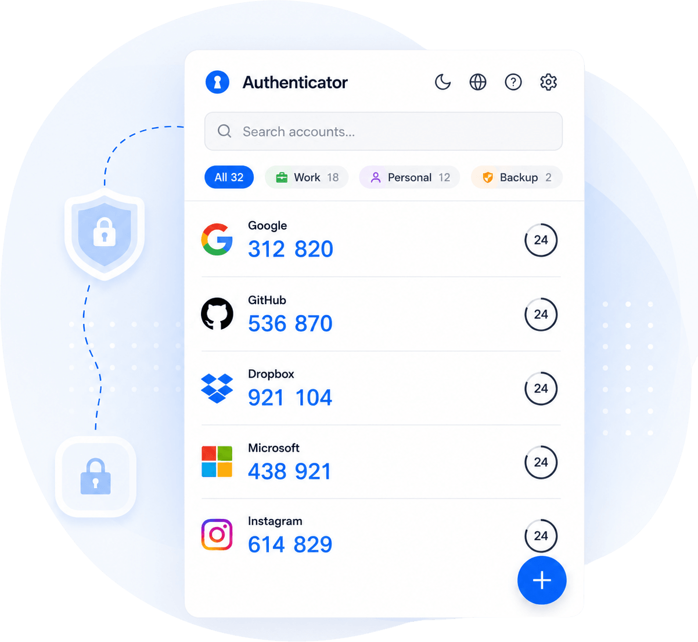

<div align="center">


**TOTP codes in Chrome. Your secrets never leave your device. No host permissions.**

[](https://chromewebstore.google.com/detail/2FA/ebhcbenbgjmaebpgbldimndmfomjmphd)
[](https://chromewebstore.google.com/detail/2FA/ebhcbenbgjmaebpgbldimndmfomjmphd)
[](https://chromewebstore.google.com/detail/2FA/ebhcbenbgjmaebpgbldimndmfomjmphd/reviews)
[](https://github.com/authenticator-sh/2fa/actions/workflows/checks.yml)
[](#permissions)
[](LICENSE)

[Install](https://chromewebstore.google.com/detail/2FA/ebhcbenbgjmaebpgbldimndmfomjmphd) ·
[Website](https://authenticator.sh) ·
[How it works](https://authenticator.sh/how-it-works) ·
[Security](https://authenticator.sh/security) ·
[Privacy](https://authenticator.sh/privacy) ·
[FAQ](https://authenticator.sh/faq) ·
[Feature requests](https://authenticator.featurebase.app)



</div>

A privacy-focused TOTP authenticator for Chrome. Your secrets, account names and codes never leave your device: accounts are stored by the browser, and optionally synced through your own Google account — see [Where your data lives](#where-your-data-lives). The extension does check in with our server once a day with an anonymous install id and a handful of numbers, for the free plan and Pro — see [What is sent to our server](#what-is-sent-to-our-server).

## Features

- TOTP code generation (SHA-1, SHA-256, SHA-512; 6 to 10 digits, 7 included — it is issued in the wild). Counter-based HOTP is deliberately refused rather than stored as TOTP, which would look healthy and never once be valid.
- QR code import from image upload, the visible tab, or a camera
- Right-click a code field on any site to insert the code for it, without opening the popup (see [Inserting a code into a page](#inserting-a-code-into-a-page))
- **Optional password protection** — AES-256-GCM encryption of every account
  record and backup, with a recovery code so a forgotten password is not a
  dead end (see [Password protection](#password-protection))
- **Passkey unlock** — open a password-protected vault with Touch ID, Windows
  Hello or your phone through the WebAuthn PRF extension, with no new permission
  (see [Unlocking with a passkey](#unlocking-with-a-passkey))
- **Share an account's codes by link**, for five minutes to an hour — the link
  carries pre-computed codes, never the secret, and there is no server behind
  it (see [Sharing codes by link](#sharing-codes-by-link))
- **Open where you need it** — the toolbar icon can open the popup, a floating
  window, or Chrome's side panel; the last two stay put while you switch tabs,
  which a popup cannot do because it closes as soon as it loses focus
- **Password-protected backup files** on export
- Automatic local backups in IndexedDB with rotation (7 latest)
- Export and import for cross-device migration, including
  [Credential Exchange Format](#credential-exchange-format) — the FIDO Alliance
  interchange format other password managers and authenticators can read
- 20 UI languages, chosen from the browser's own language on first open and overridable in Settings
- Works fully offline — codes never need a connection, and the popup renders before any network request
- Free to use; new installations may have an account limit, which **Pro** removes (see [Free and Pro](#free-and-pro))

## Permissions

The extension requests the **minimum permissions** required for its functionality:

| Permission   | Reason                                                                          |
|--------------|---------------------------------------------------------------------------------|
| `storage`    | Store accounts and settings in `chrome.storage` (local, session and optional sync) |
| `activeTab`  | Read the current tab's hostname to highlight the matching account, capture the tab for QR scanning, and — only when you pick the right-click item — insert a code into that tab |
| `contextMenus` | Add the single "Insert 2FA code" item to the right-click menu on text fields |
| `scripting`  | Run the insert routine in the tab, for that one invocation, under the `activeTab` grant the click provides |
| `sidePanel`  | Open the app in Chrome's side panel, when you pick that in Settings → Open as. It grants the extension nothing about the browser or its tabs: it is what lets an extension page be docked beside them |

Camera scanning needs no manifest permission: it uses the browser's standard
camera prompt on an extension page, granted per extension origin and revocable
in site settings. It is never requested until the scanner is opened.

The extension does **not** request:
- `host_permissions` of any kind
- Content scripts — nothing of this extension is declared to run on any page,
  and nothing of it is running on a page you have not invoked it from
- `tabs`, `cookies`, `webRequest`, or any other broad permissions

This means the extension **cannot read or modify any page on its own**. Two
things happen on your instruction and nowhere else: under `activeTab` it reads
the active tab's hostname while the popup is open, to highlight the account
matching that site — switchable off in Settings, which also erases the history
it collected — and it inserts a code into a page when you pick it out of the
right-click menu.

### Inserting a code into a page

Right-clicking a text field offers one item, "Insert 2FA code" — removable in
Settings. The same action has a keyboard shortcut, `Ctrl+Shift+Y`
(`⌘⇧Y` on macOS), which can be changed or cleared at
`chrome://extensions/shortcuts`. Choosing either is what grants `activeTab`: for
that one invocation, in that one tab, the extension may put the code for the
site into the field you clicked. The grant ends with the invocation, nothing is
left behind in the page, and no code of ours runs there again until you ask
again.

Which account is chosen is deliberately conservative. An account you have
already used *on that site* wins — inserted into a field there, or picked when
this asked you which account the site wanted. Failing that, the site's name has
to match exactly one account. Anything less certain — several plausible
accounts, none at all, or a locked vault — opens the popup and lets you pick,
because these forms often submit themselves on the last digit and a wrong code
spends one of the few attempts the service allows.

A code copied out of the popup is deliberately not treated as evidence about
the site behind it. Codes get copied for things that are not the page at all —
a VPN client, an SSH prompt, a phone — so a copy never displaces the account a
site names, and never authorises inserting anything on its own.

If the field will not take the code — some sites build their inputs in ways no
insertion survives — it is copied to your clipboard instead and a note in the
page says so. The fallback is the point: the worst case is the paste you would
have done anyway.

## Password protection

Password protection is **optional and off by default**. With it off, account
records are stored unencrypted in `chrome.storage.local`, protected by the OS
user account and the Chrome profile — the same model as most authenticator
extensions. With it on:

| Property            | Value                                                          |
|---------------------|----------------------------------------------------------------|
| Cipher              | AES-256-GCM (random 96-bit IV per record)                      |
| Key derivation      | PBKDF2-HMAC-SHA256, 600,000 iterations, 128-bit random salt    |
| Master key          | 256-bit random, generated once; the password only wraps it     |
| Fingerprints        | HMAC-SHA256 under an HKDF subkey of the master key             |
| Unlocked key store  | `chrome.storage.session` (memory only, cleared on browser exit) |
| Auto-lock           | Every open / 5 / 15 / 60 min idle / until browser closes       |

Design notes:

- **Two-level keys.** Data is never encrypted with a password-derived key
  directly. A random master key encrypts the records; PBKDF2 output only wraps
  that master key. Changing the password rewrites 32 bytes rather than
  re-encrypting every record — the bulk rewrite is where data gets lost.
- **Recovery code.** A 160-bit code independently wraps the same master key, so
  a forgotten password is recoverable. It is shown once, must be typed back to
  confirm, and is rotated after each use. A reset writes nothing until the
  replacement code has been typed back, so until then the old password and the
  old code both still work.
- **What is encrypted.** The entire account record except its `id` and
  fingerprint — including the service name, so a stolen profile leaks no
  metadata about which services the user has accounts with.
- **Backups too.** IndexedDB snapshots store the already-encrypted records.
  Enabling the vault wipes every pre-existing cleartext copy (local, sync and
  all snapshots) after a decrypt-and-compare round trip verifies the encrypted
  data reads back identically. Verification happens before anything is deleted.
- **Export files** carry their own salt and a password chosen at export time,
  independent of the vault, so a backup stays openable on a machine that has no
  vault configured.

**Threat model.** This protects data at rest: a stolen profile directory, an
infostealer that exfiltrates browser data, or account records reaching Google's
servers through Chrome sync. It does **not** protect against malware running as
the user while the vault is unlocked, or a keylogger capturing the password.

Crypto lives in [`src/utils/crypto.ts`](src/utils/crypto.ts) and
[`src/utils/vault.ts`](src/utils/vault.ts); no cryptographic primitive is
hand-rolled — all of it is WebCrypto.

## Unlocking with a passkey

Available once password protection is on, and off until you add one. A passkey
becomes a **third wrapper around the same master key**, alongside the password
and the recovery code.

| Property           | Value                                                        |
|--------------------|--------------------------------------------------------------|
| Mechanism          | WebAuthn `prf` extension, `eval.first` over a 256-bit stored salt |
| Key derivation     | HKDF-SHA256 over the 32-byte PRF output, `info` = `authenticator-vault-passkey-v1` |
| Relying party      | the extension's own origin; **no host permissions**          |
| User verification  | `required` — presence alone must not release the wrapper     |
| Stored in metadata | credential id, PRF salt, wrapped master key. Never the master key or the PRF output |

Design notes:

- **Additive, never exclusive.** `attachPasskey` only ever adds a wrapper;
  nothing in the codebase removes `wrappedByPassword` or `wrappedByRecovery`. A
  lost passkey costs convenience, not accounts — a passkey-only vault would be a
  new way to destroy every seed.
- **Verified before it is written.** The wrapper is built, unwrapped again and
  compared byte for byte with the key it came from, all in memory. Only a match
  reaches storage, so an authenticator that cannot reproduce its own PRF output
  never leaves behind a wrapper that opens nothing.
- **A password change does not break it.** Only the password wrapper is rebuilt;
  the master key is unchanged, so the passkey keeps working. Covered by a test,
  because the failure would have been silent until the day it mattered.
- **It runs in its own window.** [`src/passkey/`](src/passkey/) is a full
  extension page, opened with `chrome.windows.create({type: 'popup'})` — no
  permission required. Chrome destroys the action popup on focus loss and the
  authenticator prompt takes focus, so the ceremony cannot complete inside the
  popup at all; a window keeps it a dialog rather than an opened tab, and falls
  back to a tab if the window is refused.
- **Uneven platform support is expected.** PRF is solid on Android, Windows 11
  25H2+, macOS 15+ and iOS 18.4+, and absent on Firefox for Android. The setting
  hides itself where the API is missing and reports the case where an
  authenticator declines PRF rather than failing obscurely.
- **The popup listens instead of polling.** The ceremony happens in another
  context, so the popup subscribes to `chrome.storage.onChanged`: a session
  change re-reads the lock state, and a `vault_meta` change re-reads whether a
  passkey is registered. Without this the popup sat on its lock screen with the
  vault already unlocked behind it until it was closed and reopened, and the
  settings panel kept offering to add a passkey that already existed. After a
  successful unlock the ceremony window also tries `chrome.action.openPopup()`
  — best effort, since it needs a user gesture that the biometric prompt may
  have outlived and does not exist before Chrome 127 — and then closes itself.
- **A one-shot hand-off crosses the context boundary.** The ceremony page is a
  separate JS context, and with auto-lock on *every open* the unlocked key is
  deliberately never written to `chrome.storage.session` — so without a hand-off,
  registering a passkey is impossible on that setting and unlocking with one
  silently does nothing. Both were reproduced before the fix. `stageKeyHandoff`
  and `consumeKeyHandoff` pass the key once, under a separate session key, with a
  two-minute expiry; it is deleted on first read, refused when stale, and cleared
  by `lock()`. That keeps what auto-lock *every open* actually promises — the key
  does not outlive the popup that used it — while letting a biometric prompt in
  another window count as the authentication event for exactly one popup.

Implementation: [`src/utils/passkey.ts`](src/utils/passkey.ts) (ceremonies only,
holds no key material) and the passkey functions in
[`src/utils/vault.ts`](src/utils/vault.ts).

## Credential Exchange Format

CXF is the FIDO Alliance's JSON interchange format for credentials. It covers
TOTP secrets as well as passkeys, which makes it the first format this extension
can both write and read that other vendors also speak.

- **Export**: a third option next to the plain and password-protected files.
- **Import**: recognised automatically, so there is no format to choose.
- **The secret** is written as plain RFC 4648 Base32, byte for byte as stored. A
  test asserts the exact string, because a re-encoding bug here produces
  confidently wrong codes rather than a visible failure.
- **Every credential of every item** is examined on import. Password managers
  put a TOTP credential in the same login item as the password; walking only the
  first would drop the 2FA half of the file.
- **One bad row never costs the file.** Unreadable entries are counted and
  reported; the rest import.

CXP, the protocol half of the standard, is deliberately not implemented: it
negotiates provider-to-provider transfer through the operating system, which an
extension cannot do. Implementation: [`src/utils/cxf.ts`](src/utils/cxf.ts).

## Sharing codes by link

A link that shows another person a live code for one account, for a limited
time, in any browser and with nothing to install. Implementation:
[`src/utils/share.ts`](src/utils/share.ts); the page that opens it lives in the
site repository at `authenticator.sh/s`.

- **The secret never leaves the device.** TOTP is deterministic, so the codes
  for the next hour can be computed now and handed over on their own. The link
  holds that run — one code per period — and nothing that could produce a code
  after it. The time limit is not a rule the page enforces; it is the absence
  of any further codes.
- **An hour is the maximum**, and the page refuses longer runs. An hour of
  six-digit codes is about 550 characters: readable as a QR code from a screen,
  which is the one way to pass a link that leaves no copy in a messenger's
  cloud, and short enough for email clients that wrap at 998 characters.
- **There is no server.** The whole payload travels in the URL fragment, which
  browsers never send to a host. Nothing is uploaded when a link is made and
  nothing is stored when it is opened, so there is no database of shared codes
  to breach and no revocation that would be theatre.
- **Optional password.** Without one, the sixteen random bytes in the link are
  the key (HKDF-SHA256). With one, the key is PBKDF2 of the password salted
  with those bytes — the same stretching as the vault — so the link alone and
  the password alone are each useless. The two-byte header that says "ask for a
  password" is authenticated with the body, so it cannot be flipped in transit.
- **The two sides share a fixture, not code.** The extension seals links and
  the site opens them; `test/fixtures/share-vectors.json` pins the exact bytes
  for six cases and both repositories assert against it.

## Building from Source

### Prerequisites

- Node.js 20.x LTS
- npm 10.x

### Build

```bash
npm ci
npm run build
```

The resulting `dist/` directory is the unpacked extension.

### Load in Chrome (development)

1. Open `chrome://extensions/`
2. Enable **Developer mode**
3. Click **Load unpacked** and select the `dist/` directory

### Development

```bash
npm run dev
```

### Tests

```bash
npm test
npm run verify      # typecheck + npm test + check:deps
```

`npm run verify` needs internet access: its last step, `check:deps`, talks to
the real time sources the extension depends on (that is its whole point — see
`scripts/check-deps.ts`), so offline it fails even when the code is fine. Run
`npm run typecheck && npm test` for the offline part.

```bash
npm run build && npm run check:bundle   # check the built package in dist/
npm run test:e2e                        # the built extension in real Chromium
```

`check:bundle` reads the build rather than the source: it walks the service
worker's static imports and fails if any file it reaches contains `import()`
(Chrome refuses it in a service worker), and it checks that the manifest, the
default locale, the icons and every HTML page the extension opens are in the
package.

`test:e2e` builds into `.e2e-build/` — never `dist/` — and loads that unpacked
into Chromium with Playwright: adding an account and reading it back from
`chrome.storage.local`, the code on screen against one computed independently,
a delete seen from a second window, Undo, and a service worker that starts
without errors. The first run needs the browser: `npx playwright install
chromium`. External network is blocked inside the tests.

End-to-end scenarios for the storage and vault paths — enabling, locking,
password change, recovery-code reset, encrypted export, disabling — run against
real WebCrypto with `chrome.storage` and IndexedDB mocked. These cover the code
where a bug means permanent loss of a user's 2FA seeds, so they run the real
modules rather than stubs.

The passkey suite covers the wrapper rather than the WebAuthn ceremony, which
cannot run under Node: a stand-in PRF output proves that adding a passkey never
removes the password or recovery wrapper, that a password change and a
recovery-code reset both leave it working, and that neither the master key nor
the PRF output is ever written to metadata.

## Verifying the Chrome Web Store Build

To verify that the version published on the Chrome Web Store was built from this source code:

1. Download the `.crx` for the published version from the Chrome Web Store
2. Unzip it to a directory
3. Check out this repository at the matching git tag (e.g. `v1.13.2`)
4. Run `npm ci && npm run build` using **Node 20 LTS**
5. Compare the `dist/` directory contents with the unzipped `.crx`

Differences should only exist in:
- File ordering inside zips
- Whitespace differences in minified output across Node patch versions

For each release we publish `SHA256SUMS-v<version>.txt` — a SHA-256 for every file in the produced `dist/` — in [GitHub Releases](https://github.com/authenticator-sh/2fa/releases). It is in `sha256sum` format, so you can check your own build against it directly:

```bash
cd dist && sha256sum -c ../SHA256SUMS-v1.13.2.txt   # shasum -a 256 -c on macOS
```

## Architecture

```
src/
├── background/
│   ├── service-worker.ts    # MV3 service worker: install/uninstall URLs, menu, shortcut
│   ├── quick-fill.ts        # Right-click flow: pick account, generate, inject
│   └── quick-fill-page.ts   # The only code that ever runs in a page (injected on demand)
├── popup/
│   ├── App.tsx              # Main UI
│   └── index.tsx
├── scan/
│   └── App.tsx              # Camera QR scanner (own tab — see the file header)
├── passkey/
│   └── App.tsx              # Passkey ceremony (own tab — the popup dies on focus loss)
├── components/              # React components
├── hooks/
│   ├── useAccounts.ts       # Account state + auto-backup
│   ├── useVault.ts          # Lock/unlock state
│   └── useTOTP.ts           # TOTP refresh loop
├── utils/
│   ├── crypto.ts            # WebCrypto primitives (PBKDF2, AES-GCM, HKDF)
│   ├── vault.ts             # Vault lifecycle: unlock, auto-lock, recovery, passkey
│   ├── passkey.ts           # WebAuthn PRF ceremonies (no key material)
│   ├── storage.ts           # Local-primary storage, encryption layer, retry
│   ├── backup-file.ts       # Plain and password-protected export formats
│   ├── cxf.ts               # Credential Exchange Format read/write
│   ├── auto-backup.ts       # IndexedDB backup rotation (7 latest)
│   ├── vault-prompt.ts      # When to offer password protection
│   ├── time-sync.ts         # Optional clock-drift check
│   ├── totp.ts              # TOTP via OTPAuth
│   ├── qr-parser.ts         # QR decoding
│   ├── migration-parser.ts  # Google Authenticator export parser
│   ├── suggestions.ts       # Which account belongs to the site you are on
│   └── screen-capture.ts    # captureVisibleTab wrapper (activeTab only)
└── types/
```

## Network Access

The extension never sends your secrets, account names, issuers, codes or the sites you use them on in a form we can read — Pro's [cloud backup](#cloud-backup-pro-off-until-you-turn-it-on), if you turn it on, sends your accounts end-to-end encrypted. Two kinds of request happen automatically — the cached clock check and the daily billing check-in, both below — and a third with cloud backup on; everything else happens because you clicked something. In full, the outbound HTTPS calls are:

| URL                                         | When                          | Purpose                        |
|---------------------------------------------|-------------------------------|--------------------------------|
| `https://www.authenticator.sh/welcome?iid=<install id>` | First install | Opens welcome page in a new tab. The site passes the install id to our server only for a browser that came from one of our ads, to tell which campaign led to installs that went on to use the extension; it never goes to Meta. The page may ask the extension to open its popup — the one message the extension accepts from any web page (`externally_connectable`, authenticator.sh only, `src/background/site-open.ts`); the reply says only whether it opened |
| `https://www.authenticator.sh/uninstall?i=<install id>&s=<stage>` | After uninstall (Chrome API) | Opens feedback page, which reports the removal to our server by that id, with how far a new install got towards a first account (`opened`, `pick:ga`, `fail:camera:camera_denied`…), and links an optional answer to it |
| `https://api.authenticator.sh/v1/sync`      | Once a day (browser start or popup open, after it has rendered); in a new install's first three days also within minutes of a step towards a first account | Check-in — see [What is sent to our server](#what-is-sent-to-our-server) |
| `https://api.authenticator.sh/v1/checkout`, `/v1/license/*`, `/v1/portal` | User starts a purchase, enters a key, restores a purchase or manages a subscription | Pro |
| `https://api.authenticator.sh/v1/backup/*` | Cloud backup is on and the list changed (popup open); Settings → Backup & Restore opened with Pro or with cloud backup on (the list of copies); or the user turns it on or off, backs up, restores or starts over | Pro cloud backup — encrypted copies, see [Cloud backup](#cloud-backup-pro-off-until-you-turn-it-on) |
| `https://checkout.stripe.com/…`, `https://billing.stripe.com/…` | User starts a purchase or manages a subscription | Stripe Checkout and customer portal, in a new tab |
| `https://chromewebstore.google.com/.../reviews` | User takes the rating prompt | Opens the Web Store review form |
| `https://www.authenticator.sh/support`      | User clicks "Help & support"  | Opens the support page         |
| `https://www.authenticator.sh/faq` (or `/<lang>/faq`) | User clicks the help icon, or "How do I fix this?" on the clock warning | Opens the answers, in the popup's language |
| `https://authenticator.featurebase.app`     | User clicks "Request a feature" | Opens the public feature board |
| `https://chromewebstore.google.com/detail/password-manager/...` | User clicks the cross-promo banner | Opens our other extension's listing |
| `https://time.akamai.com/?iso`              | Popup open (optional, cached) | Clock drift detection for TOTP |
| `https://timeapi.io/api/time/current/zone?timeZone=UTC` | Popup open (optional, cached) | Clock drift detection for TOTP |
| `https://cloudflare.com/cdn-cgi/trace`      | Popup open (optional, cached) | Clock drift detection for TOTP |

Camera scanning uses `getUserMedia` on an extension page opened in a tab. That
needs no manifest permission — it goes through the browser's standard camera
prompt, granted per extension origin and revocable in site settings. It is
never requested until the user opens the scanner.

The clock-drift requests are unauthenticated GETs that carry no user data and
are cached. Any two of the three agreeing is enough, so one host going offline
does not disable the check — and when none of them can be reached, Settings
says so rather than reporting a clock it never measured. No fonts, scripts, or styles are loaded from remote
hosts — everything needed to render the popup is bundled.

## Free and Pro

Installations that existed before billing (1.14.0) keep **unlimited accounts**.
New installations may have a limit on how many accounts they hold for free —
our server decides whether there is one and how high it is; **Pro** removes
it. The limit only ever stops *adding* an account: every account you have
keeps working, exporting, backing up, restoring and syncing with or without
Pro, and nothing is ever hidden or locked.

- The limit is checked on your machine from the last policy our server
  signed, so it works offline: a limit already received still applies without
  a connection. Until the extension has reached our server once, nothing is
  limited — and nothing is again once it has not reached it for 14 days, until
  it does.
- An account the limit stops on its way to Checkout is kept in memory (see
  `chrome.storage.session` below) and added by itself once Pro turns on; it is
  dropped after a day, when the browser closes, or when you choose not to add it.
- Pro is a license signed by our server (ES256) and checked with WebCrypto
  against the public key in `src/billing/keys.ts`. A subscription's signed
  license lasts offline for up to 60 days at a time and is renewed silently
  whenever the extension is online; it never runs past the paid period plus
  two weeks (plus one day if renewal was cancelled). A lifetime license lasts
  half a year at a time, renewed the same way.
- When Pro is offered to an installation, it appears in **Settings → Pro**.
  Buying happens on Stripe Checkout in a new tab; Stripe (through Link) is the
  merchant of record. Pro turns on by itself in the browser you bought it in,
  which is then sent the license key; while Chrome sync is on, the key goes to
  Chrome Sync and your other Chrome profiles turn Pro on by themselves. On
  another computer, enter the license key (`2FA-XXXXX-…`) from the success
  page or the email under **Settings → Pro**.
- The code is open source, so the limit is there for honest users — it is not
  DRM, and a fork can remove it.

### Cloud backup (Pro, off until you turn it on)

Pro can keep an **end-to-end encrypted** copy of your accounts on our server,
so losing the computer does not mean losing the codes. It is off until you
turn it on in **Settings → Backup & Restore**, and it is the only feature that
sends your accounts to us — encrypted with a key we never see (the daily
check-in sends only their number).

- Turning it on shows a **backup recovery code** (`XXXXX-XXXXX-XXXXX-XXXXX`,
  about 101 bits from the browser's random generator) and asks you to type it
  back before anything is stored; closing the popup meanwhile keeps the same
  code. The copies are encrypted with AES-256-GCM under a key derived from that
  code with HKDF-SHA256 (`src/billing/cloud-backup.ts`). The code is kept in
  this browser and, while Chrome sync is on, in your Google account so your
  other Chrome profiles can open the same copies. It is never sent to us: we
  cannot open the copies, and cannot recover them if the code is lost.
- With password protection on, the stored code is itself encrypted under the
  vault's key — sealed the moment protection is turned on, opened again when
  it is turned off — so the copies cannot be fetched and opened from this disk
  without your password.
- **One code per license.** The server keeps the current code's `kid` (a short
  hash that tells a device which code a copy needs) and a hash of `auth`, a
  second value derived from the code that proves a device holds it. It refuses
  a copy under any other code and after cloud backup was turned off, and a
  browser told so forgets its code and asks for the current one.
- A copy is sent when you turn it on, when you press **Back up now**, and
  otherwise when the extension opens and what it holds — including records it
  cannot read, such as another vault's — differs from the last copy that
  browser sent. Typing the code on a new browser first merges the newest copy
  into it (adding only what is missing), and sends a copy only if that browser
  held accounts the copy lacked — the two lists together — so a new browser's
  partial list never becomes the newest copy. Each time a
  copy arrives the server keeps the 20 newest, the newest of each hour of the
  last day, the newest of each day for 30 days, and the newest from each of
  the 10 most recently active browsers, and deletes the rest.
- Restoring only adds accounts that are missing, like the automatic copies. On
  another computer: activate the license key, then enter the backup recovery
  code. After Pro has ended: **Restore from cloud backup with your license
  key** finds the copies with the key; the backup recovery code opens them.
- If Pro ends, no new copies are made; the existing ones are deleted 90 days
  after it ended, unless it is renewed — or bought again from a browser that
  held the earlier license, whose backup (code and copies) the new license then
  takes over. Turning cloud backup off needs the
  code, deletes every copy of the license, and removes the code from this
  browser and from Chrome sync; the other browsers stop on their next copy.
  Lost the code: **start over with your license key** deletes the copies so a
  new code can be made.

## What is sent to our server

Once a day — and, in a new install's first three days, within minutes of a
step towards a first account (at most every five minutes, `src/billing/onboarding.ts`) —
the extension sends `https://api.authenticator.sh/v1/sync` exactly
these fields (`src/billing/sync.ts`, `buildSyncRequest`; a test holds it to the
list):

| Field | What it is |
|---|---|
| `iid` | A random id created by this installation. Not linked to your Google account, email or browser — unless you buy Pro: then the purchase record links the installation you bought from, and any installation where your license key is active, to the email you paid with |
| `ver`, `ui_lang`, `browser_lang` | Extension version, interface language, browser language |
| `installed_at`, `legacy`, `legacy_src` | When this installation appeared, and whether it predates billing |
| `accounts` | **How many** accounts you have — a number, never which ones |
| `vault`, `sync`, `open_mode`, `style`, `dark` | Whether password protection and sync are on, how the extension opens, and which of its two styles it is drawn in, light or dark |
| `pid`, `lid` | Which policy and license this installation currently holds |
| `has_key`, `key_hint` | Whether this installation holds a license key, and the last four characters of it. The installation Pro was bought on is sent its key in the response (`key`) until those four characters match it — so a key bought later replaces an older one; one where a key was typed in already has it and is never sent one |
| `opens` | How many times the extension was opened on each day since the last check-in (at most the last 14 days) — a count per day, nothing about what was looked at |
| `events` | Up to 50 queued events from a closed list (`src/billing/events.ts`). Billing: the limit was reached, the paywall was shown or closed, a plan was chosen, a checkout or a key was tried, a banner or a notification behind the bell our server set was shown, clicked or closed (its id, action and place), the bell was opened (how many notifications it held and how many were new). The way to a first account: first open, whether the welcome page asked the extension to open and it did, the "add your first account" screen shown and the way picked on it, each add screen reached, each error shown or add left (as a kind — `error_no_qr`, `camera_denied` — never what was scanned or typed), accounts added and by which way, the first code copied or filled in. Never an account's name, issuer, secret or site |

The server sees the request's country (from its edge, the IP address is not
stored). If you buy Pro, Stripe gives us your email address, to send and
restore your license key, and keeps the install id you bought from in the
purchase's metadata. Retention and your rights are in the
[privacy policy](https://www.authenticator.sh/privacy).

## Where your data lives

| Store | Contents | Default |
|-------|----------|---------|
| `chrome.storage.local` | Accounts (encrypted when password protection is on), settings, and — only while password protection is off — the per-site usage history | Always used; primary |
| `chrome.storage.session` | The unlocked master key, the selected group filter and the per-site usage history; and an account the free limit stopped on the way to Checkout, until Pro turns on (sealed with the vault's key when password protection is on) — memory only, cleared when the browser closes | Only while unlocked; a stopped account for a day at most |
| `chrome.storage.sync` | A copy of the accounts and the vault metadata, replicated by Chrome **through the user's own Google account** | On, switchable off |
| IndexedDB | Seven rolling snapshots, in the same form as the primary store | Always used |
| `chrome.storage.local` (`billing*`) | The install id, the last signed policy and license, the license key this installation holds — typed in, or received after buying on it — and queued billing events and daily open counts — no account data | Always used |
| `chrome.storage.sync` (`billingLegacy`, `billingLicenseKey`) | Whether this person predates billing, and the license key this installation holds — so their other Chrome profiles pick both up and turn Pro on by themselves | Only while sync is on; removed with the rest when sync is switched off, and put back when it is switched on again |
| `chrome.storage.local` + `chrome.storage.sync` (`cloudBackupCode`) | The cloud backup's recovery code — encrypted under the vault's key when password protection is on | Only after turning cloud backup on; the sync copy only while sync is on, removed with the rest when sync is switched off |
| Our server (`/v1/backup/*`) | Cloud backup copies, encrypted in the browser with a key we never receive; kept as described in [Cloud backup](#cloud-backup-pro-off-until-you-turn-it-on) | Only after turning cloud backup on (Pro) |

Two consequences worth stating plainly:

- **With password protection off, accounts sit in sync in the clear**, which
  means Chrome replicates them to Google. That is the user's own Google account
  and we never see them, but it is not "on the device only". Turning password
  protection on encrypts them before they are ever handed to sync; turning sync
  off in Settings stops the replication and removes what is already there.
- **The per-site usage history is not covered by the vault** while it is being
  collected. Enabling password protection deletes it, and it can be switched off
  independently.

We never receive your secrets, account names or codes in a form we can read: [cloud backup](#cloud-backup-pro-off-until-you-turn-it-on), if you turn it on, sends them encrypted with a code we never see. What our billing server does receive is listed in [What is sent to our server](#what-is-sent-to-our-server).

## Security

See [SECURITY.md](SECURITY.md) for the responsible disclosure policy.

Report security issues to **security@authenticator.sh** — please do **not** open a public issue for security bugs.

## Contributing

Bug reports and pull requests are welcome. Please read [CONTRIBUTING.md](.github/CONTRIBUTING.md) before submitting, and the [Code of Conduct](.github/CODE_OF_CONDUCT.md) for how we expect people to treat each other here.

## Docs

- [Installing from source](docs/install.md)
- [Release notes](docs/release-notes/) — what changed in each version
- [Release checklist](docs/releasing.md) and [review checklist](docs/review-checklist.md)

## Technology

- React 18, TypeScript, Tailwind CSS
- Vite (build)
- [OTPAuth](https://github.com/hectorm/otpauth) (TOTP/HOTP)
- [jsQR](https://github.com/cozmo/jsQR) (QR decoding, lazy-loaded)
- Lucide React (icons)

## License

[MIT](LICENSE)
